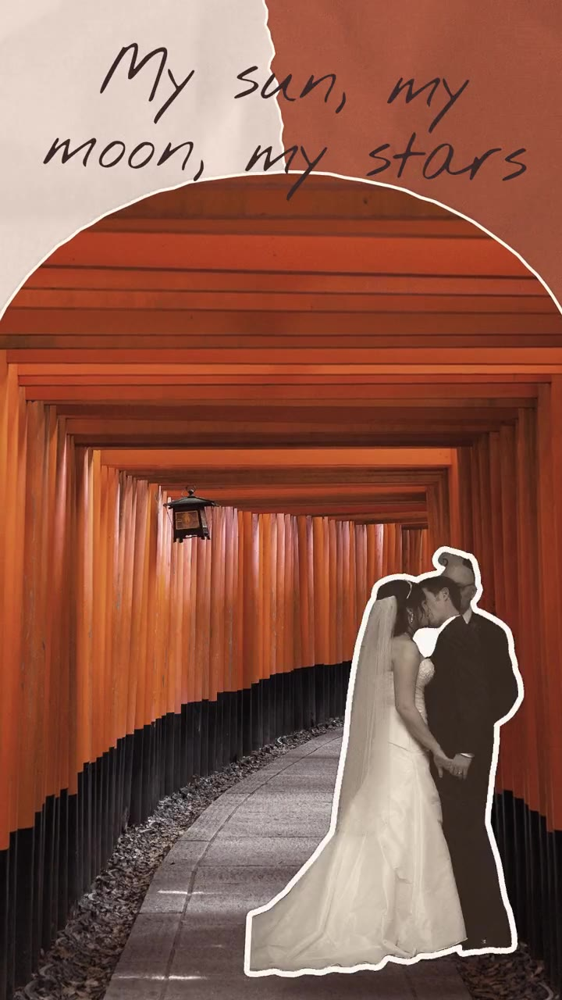
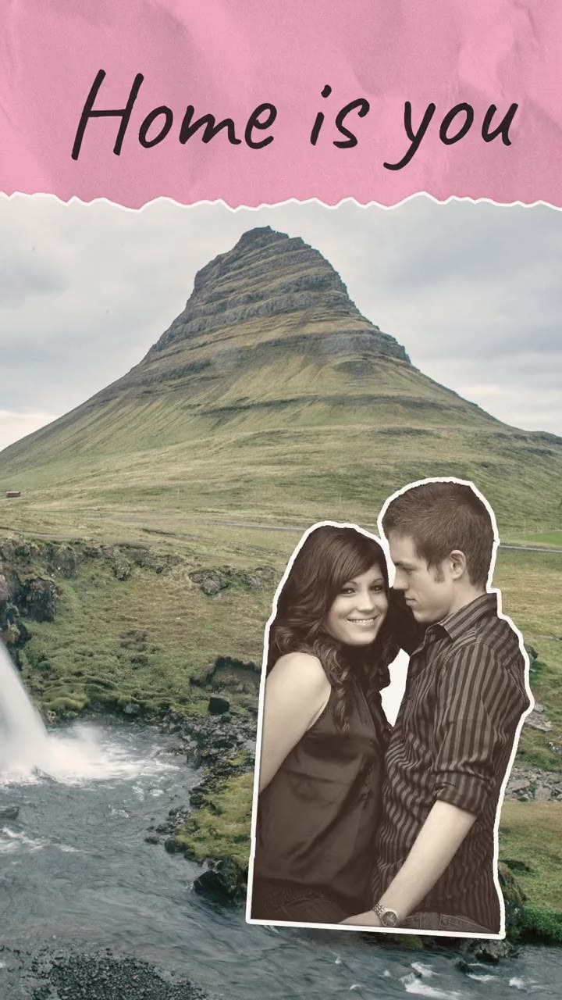

# skills

个人 Agent Skills 合集（公开仓库）。每个目录是一个独立的 skill，可直接复制到任何支持 Agent Skills 的工具里使用。SKILL.md 里引用的文件全部用相对路径，整个目录拷走即可离线使用。

## 在线 registry

所有 skill 同步发布在 **https://oceanz.me/skills**（浏览器打开是卡片列表；Agent 用 `https://oceanz.me/skills?format=md` 浏览、`https://oceanz.me/skills/<slug>?include=all` 一次拿到某个 skill 的全部内容）。线上路径与本仓库目录同构：`<slug>/references/x.md` ⇔ `https://oceanz.me/skills/<slug>/references/x.md`。API 说明见 https://oceanz.me/skills-api 。

## 结构

```
<slug>/
  SKILL.md          # 主文件，frontmatter 的 name 必须等于 <slug>
  references/       # 按需读取的参考文档
  scripts/          # 配套脚本
  assets/           # 模板、示例、图片
```

## 效果预览

所有案例都用网上示例素材渲染，点封面看视频。

| collage-sticker-doodle · invite-classic | scrapbook | retro-poster | graffiti | collage-stopmotion-invite |
|---|---|---|---|---|
| <a href="collage-sticker-doodle/examples/demo_invite_classic.mp4"></a> | <a href="collage-sticker-doodle/examples/demo_scrapbook.mp4"></a> | <a href="collage-sticker-doodle/examples/demo_retro_poster.mp4"></a> | <a href="collage-sticker-doodle/examples/demo_graffiti.mp4"></a> | <a href="collage-stopmotion-invite/examples/demo_invite.mp4"></a> |

- `video-style-distill`：[拆解报告](video-style-distill/examples/distill_analysis.md)、[色板](video-style-distill/examples/distill_palette.png)、[脚手架冒烟渲染](video-style-distill/examples/demo_scaffold.mp4)
- `zh-ai-tool-viral-post`：[成品帖示例](zh-ai-tool-viral-post/examples/example_post_B.md)

## Skills 列表

| slug | 一句话 | 状态 |
|---|---|---|
| [`zh-ai-tool-viral-post`](zh-ai-tool-viral-post/) | 写中文 AI 工具种草爆款短帖 | 可用 |
| [`collage-sticker-doodle`](collage-sticker-doodle/) | 通用贴纸涂鸦拼贴定格视频生成器（含锁定的婚礼请柬包 `invite-classic`） | 可用，**推荐** |
| [`collage-stopmotion-invite`](collage-stopmotion-invite/) | 拼贴手账定格风婚礼请柬视频（v8） | 已被 `collage-sticker-doodle` 的 `invite-classic` 取代，保留备查 |
| [`video-style-distill`](video-style-distill/) | 把任意风格参考蒸馏成一个新的视频生成 skill | 可用 |
| [`match-cut-discovery-montage`](match-cut-discovery-montage/) | 弧线地平线匹配剪辑 · 发现蒙太奇风格的 20 秒品牌/产品发布短片（越切越快 + 逐词白字，收在产品名和品牌） | 可用 |
| [`mlh-cursor-pro-claim`](mlh-cursor-pro-claim/) | 报名 MLH Global Hack Week 并 check-in，领取免费 Cursor Pro 的 SOP | 可用 |
| [`doubao-tts-voiceover`](doubao-tts-voiceover/) | 用火山引擎豆包语音合成 2.0 生成自媒体配音（含 SRT 字幕、语气调参） | 可用 |
| [`claude-cliproxy-vps`](claude-cliproxy-vps/) | 搭美国 VPS + CLIProxyAPI + 静态住宅代理，让 Claude Code 经代理用 Claude Pro 订阅（含省 token 设置） | 可用 |
| [`karpathy-llm-wiki`](karpathy-llm-wiki/) | Astro-Han 权威 Karpathy LLM Wiki skill（Ingest / Query / Lint；含 Shiper Notion 路径映射） | 可用 |
| [`cloudflare-workers-global-perf`](cloudflare-workers-global-perf/) | Cloudflare Workers（Next.js/OpenNext/D1）全球提速：含框架背景、可粘贴配置、详尽验证，以及 Vercel/Netlify/Node/Remix/CloudFront/Fastly 等对照 | 可用 |

视频类 skill 都用代码出片：HTML Canvas 逐帧绘制 + Playwright 截图 + FFmpeg 合成，Python 负责抠图、校验和 QA。

---

### zh-ai-tool-viral-post · 中文 AI 工具种草爆款推文

- **做什么**：按"中文 AI 工具种草"类账号的写法写短帖：高情绪开头、短句分行、靠数字建立可信度、结尾引导收藏或评论。
- **什么时候用**：在 X、小红书、即刻发提示词技巧、工具推荐、个人转型故事、AI 变现方法这类帖子。写严肃测评、新闻稿、正式文章时不要用。
- **需要提供**：主题，加上手头的事实和数字，比如工具名、实测数据、链接、个人经历。
- **输出**：一条约 150 字、5 到 7 行的成品帖，可附备选钩子。
- **要点**：
  - 4 套模板：A 提示词技巧、B 工具推荐、C 个人故事、D 变现方法，各有正文骨架。
  - 5 类钩子：反常识、发现、惊叹、场景、号召。
  - 风格基线来自同类账号约 320 条原创帖的统计：高频词、标点、数字占比、emoji 用法。
  - `references/source-analysis.md` 是公开账号的风格分析。

### collage-sticker-doodle · 贴纸涂鸦拼贴定格视频生成器（v4）

- **做什么**：用真人照片做竖屏拼贴定格短视频。真人抠图后加厚白边做成贴纸，配上撕纸大色块、风景建筑照拼贴、手写深墨中文和程序化贴纸涂鸦，画面按 BGM 节拍定格抖动（boil），人物在 A、B 两个站位之间闪切。
- **什么时候用**：生日、纪念日、旅行、毕业、聚会、婚礼等任何"把自己的照片做成手作拼贴感短片"的需求。要逐帧复刻原婚礼请柬片子时，选锁定包 `invite-classic`。
- **两种模式**：
  - **自由模式**：AI 读你的描述和素材，写故事板 `plan.json`，决定场景、顺序、文案、转场和闪法。可选 5 个风格包：scrapbook、magazine、retro-poster、graffiti、zine。seed 只负责故事板没写的细节，同一个 plan 加同一个 seed 能逐像素复现。
  - **锁定模式 `invite-classic`**：完整搬入 `collage-stopmotion-invite` v8 的规则，包括 38.43 秒固定时间轴、S1–S10 十个场景、TV 开场、A/B 闪只在 S5–S7、全片唯一一次硬切、色卡结尾和马善政手写体。AI 只往固定槽位里填照片、人物和文字。成片与 v8 逐帧一致。
- **需要提供**（详见 `references/asset_requirements.md`）：
  - 自由模式（38 秒）：最少 2 张人物照、1 张风景照、一句话说明场合和情绪；推荐 6 张人物照（含 2 组 A/B 对）、3 张风景照，再给名字、日期、地点；最佳效果是 10 张人物照（含 3 组 A/B 对）、6 张风景照。BGM 一首，至少 30 秒。
  - `invite-classic`：最少 8 张人物照（含 3 组 A/B 对）和 3 张风景照，推荐 11 张人物照和 5 张风景照。必须提供两人名字、日期、城市、厅名和流程时间。BGM 至少 38.5 秒。道具都已内置。
  - A/B 对指同一地点、同一身衣服连拍的两张照片，人换了站位。
- **输出**：竖屏 mp4，外加 10MB 以内的 720p 预览、QA 报告（JSON）和所用 seed。
- **要点**：
  - **第 0 步是素材预检和选片**（`scripts/precheck_assets.py`）。没给素材就列上传清单；不够或有不合格照片（分辨率低、糊、半身、人被裁）就说明缺什么、换哪张；够了就给出选片表，说明每张照片用在哪一场，等你确认后才开始渲染。
  - 7 条 P0 硬规则，每一帧都审计，违反即判失败：不越界、恰好两个人物位置、固定层级、色块大而少、信息不被盖、人物完整、人物零遮挡。
  - 抠图、人物完整性检查、素材和故事板校验、成片 QA 都有配套脚本。

### collage-stopmotion-invite · 拼贴手账定格风请柬视频（v8，已被取代）

> 它的全部规则已原样并入 `collage-sticker-doodle` 的 `invite-classic` 包，两者出片逐帧一致。新项目请用 `collage-sticker-doodle`，这里仅保留备查。

- **做什么**：逐帧拆解一条 38.43 秒的婚礼请柬参考片，做成模板。节奏锁死，画面填空：整片挂在每格 0.408 秒的定格时钟上，你只换人物、风景建筑照和文案，seed 决定装饰细节。
- **什么时候用**：要做和原片节奏、构图几乎一样的婚礼请柬视频时。
- **需要提供**：按 `assets/manifest.example.json` 写的素材清单，包括人物照（含 S5–S7 三组 A/B 对）、5 张风景建筑照（标出建筑主体框和地面线）、两人名字、日期、地点、流程和 BGM。
- **输出**：mp4 和 720p 预览、对比拼图、QA JSON、seed 和警告清单。
- **要点**：S1–S10 固定事件表；近满版的不规则照片遮罩；马善政手写体；7 条 P0 硬规则逐帧逐像素审计。

### video-style-distill · 风格蒸馏元 skill（v1）

- **做什么**：把一个风格参考蒸馏成一个新的、能直接出片的视频生成 skill，并且让成片"像原作者做的"。`collage-sticker-doodle` 就是用这套方法做出来的。
- **什么时候用**：你看到一种喜欢的视频、海报或设计风格，想以后用自己的素材反复出同款。
- **需要提供**：任意组合的视频、图片或截图、设计稿或品牌手册 PDF、设计语言的文字描述。Figma、PSD、AI 原生文件需要先导出成 PNG 或 PDF。
- **输出**：一个完整的新 skill 目录（SKILL.md、references、scripts、assets），带渲染器、故事板 `plan.json`、至少 3 个风格包、seed 随机、P0 硬规则和自动 QA，外加用新素材出的测试片。
- **流程（10 步）**：测量 → 看帧写解析 → 提炼作者签名习惯 → 定素材约束 → 规则分层（节奏硬锁，版式给默认值加容差，用户反馈升级为 P0）→ 故事板、风格包和 seed → 渲染器 → 自动 QA → 出测试片自查 → 写成新 skill。
- **要点**：
  - 测量脚本：切点、定格网格、boil 态数、A/B 闪、转场、对拍、色板、拼图；静态图可推导动效默认值。
  - 能力边界：拼贴、定格、动态排版、图形动画、扁平插画、卡点剪辑、MG 包装都能完整蒸馏。实拍运镜、复杂 3D 或特效、AI 生成画面只能蒸馏剪辑节奏和包装，动手前会先说明。

---

### mlh-cursor-pro-claim · 通过 MLH Global Hack Week 领免费 Cursor Pro

- **做什么**：一步步带你报名 MLH Global Hack Week（如 Hacktoberfest）：登录 MyMLH → 填资料 → 同意条款 → 活动 check-in → 等邮件兑换码 → 在 Cursor Billing 里兑换。
- **什么时候用**：看到 MLH 送 Cursor Pro 的推文 / 链接，想报名领取，或想知道兑换码在哪。
- **要点**：不要求学生；码是事后邮件发的；同意条款由本人勾选，不编造个人信息；群聊里卡住就转 1:1 私聊。

### cloudflare-workers-global-perf · Cloudflare Workers 全球提速

- **做什么**：给跑在 Cloudflare Workers 上的站点（尤其 Next.js + OpenNext + D1）降全球 TTFB。先用 Globalping 在 ~40 个地点 × 3 轮冷/热拨测出各区域 p50/p90，再按 `_headers` → OpenNext 静态缓存 → D1 batch + React cache() → Cache API → 瘦身 → zone 配置 → D1 读副本，一个 PR 一步上线复测。
- **什么时候用**：网站在某些地区打开很慢、全球拨测、Workers/OpenNext/D1 提速；或要把同一套思路迁到 Vercel / Netlify / 自建+CDN / Remix 等。
- **文档**：`references/background.md` 讲清 Next/OpenNext/Workers/D1/Cache API/Placement 等层；`playbook.md` + `cloudflare-settings.md` 可粘贴配置与 curl；`verification.md` 门禁与回滚；`other-stacks.md` 跨平台映射；`worked-example.md` 实战数字（首页 p50 432→68 ms）。
- **要点**：永不缓存清单；可变字段短 TTL；Placement 不随 rollback；Early Hints 无 Link 则关；冷实例双峰。

---

## 注意

`collage-stopmotion-invite/assets/slot_layout.jpg` 含参考视频的截帧，仅供私人学习研究，请勿公开分发。仓库不包含参考视频原片及其他第三方版权素材。

- `match-cut-discovery-montage`：弧线地平线匹配剪辑 · 发现蒙太奇（20s 发布短片，35 镜锁定节奏，Canvas 渲染 + QA）

- `getting-started` — first-run onboarding for the casual-chat bot template
