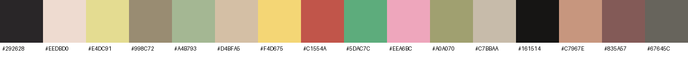
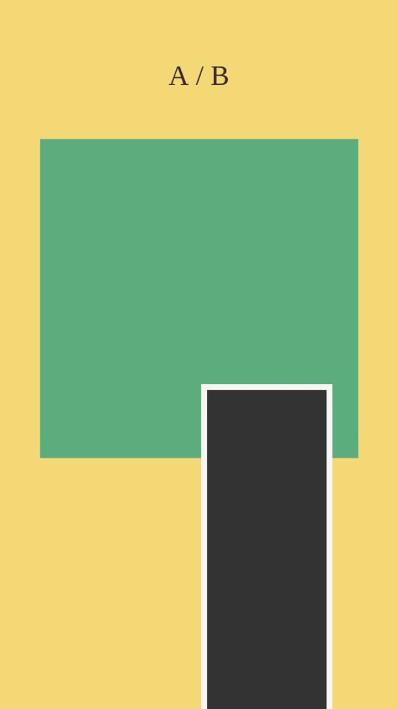

# 风格蒸馏 · 把参考做成视频生成 skill（video-style-distill v1）

输入：视频 / 图片 / PDF 设计稿或品牌手册 / 设计语言文字（可混合）。输出：一个新 skill 目录 `<slug>/`（SKILL.md + references/ + scripts/ + assets/），能按用户素材和 prompt 出片，并且"像原作者做的"。
方法来自"拼贴定格婚礼请柬"案例（collage-stopmotion-invite → collage-sticker-doodle），细节和踩坑见 `references/method.md`，案例数据见 `references/case_collage.md`。

## 先说清能力边界（动手前告诉用户）
拼贴、贴纸、定格、动态排版、图形动画、扁平插画、卡点剪辑、MG 包装：全部可蒸馏。**实拍运镜、复杂 3D/粒子/VFX、AI 生成画面：只能蒸馏剪辑节奏和包装**（字幕、贴纸、转场、配色、片头片尾），画面本身复刻不了。详见 `references/limits.md`。

## 环境
`python`（需 numpy、pillow、scipy；librosa、playwright 可选/渲染必需）+ `ffmpeg` + `pdftoppm`。box 上用 `/workspace/venv/bin/python`。下文 `S=<本 skill>/scripts`。

## 流程（10 步）
1. **测量**：`python $S/distill.py <输入...> --out work/analysis --slug <slug>`
   - 视频 → `analyze_video.py`（事件、定格 hold 比、T、boil 态数、局部层时钟、场景、A/B、分拍转场、硬切、开场快闪）、`audio_beat.py`（BPM、对拍距离、能量包络，判断卡拍还是固定网格）、`palette.py`（只信平涂区颜色）、`contact_sheet.py`（场景拼图 + 每 0.5 s 拼图）。
   - 图片/PDF → `image_style.py`（色板 + 测量 + **推导的动效默认值**，见 `references/non_video_inputs.md`）。文字描述原样附进草稿。
   - 生成 `style_analysis.draft.md`（模板 `templates/style_analysis.template.md`），数字全部标【实测】/【推】。
2. **看图 + 写解析**：逐张看 `scenes.jpg`、`sheet_*.jpg`，补全逐场景表、材质、主体处理、文字、道具、转场、构图；目测项标【估】；写"已知不确定点"。测量只说"哪里变了"，看图才知道"变的是什么"。
3. **签名与习惯**（`templates/signature.template.md`）：作者反复做的、从不做的、反模式；每条带证据。
4. **素材约束** → `validate_manifest.py`（REJECT/WARN）：数量、比例、抠图可行性、A/B 同机位、主体完整。
5. **规则分层**：🔒 硬锁 = 节奏（T 及其换 BGM 的推法、网格对齐、boil 态数、定格/连续、场景 nT）；🎚 可调默认 = 版式（位置、大小、角度、色、贴纸数，写"默认 + 容差"）；⛔ P0 = 用户反馈来的"绝对不许"（`templates/p0_rules.template.md`，每条都要可判定、有审计、有 QA）。用户要"和原片一模一样"时，额外做**锁定包**（结构签名也锁，agent 只填槽位）。
6. **随机体系**：故事板 plan.json（agent 读 prompt 写，模板 `templates/plan.schema.template.json`）→ 风格包（色板/字体/装饰集/转场偏好，至少 3 个）→ seed（只填故事板没写的细节，在容差内）。改 `$S/validate_plan.py` 成新 skill 的校验器（lock.json 写硬锁）。
7. **渲染器**：复制 `$S/render_scaffold/`（engine.js 底座不改：时钟量化、seeded RNG、元素登记 + 越界/遮挡/文字重叠审计、stateKey 去重；style.js 写风格；run.py 用 Playwright 逐帧截图，P0 违规退出码 3，`--mp4` 用 ffmpeg 合成）。主体最后画、转场期间不画主体。
8. **QA**：复制 `$S/qa_harness.py`：用同一个拆解器拆成片（T 误差 ≤3%、网格命中 ≥85%、定格静止 ≥90%）+ 渲染器 P0 = 0 + 与参考结构对比（`--ref-analysis`，用户要求的偏离 `--allow-diff`）+ qa_sheet；风格专属检查追加进 CHECKS（字形、抠图完整、主体被盖像素 = 0、色板偏差）。
9. **测试片 + 自我看片**：用新素材出 ≥1 条（有风格包就每包 1 条），自己逐场景看 qa_sheet 挑刺，修到挑不出；给用户发 720p 预览 + 与原片差异说明。用户反馈回第 5 步登记成 P0/默认值。
10. **写 skill + 发布**：按 `templates/SKILL.template.md` 写新 SKILL.md（中文，lean：P0 表、硬锁、可调默认、谁决定什么、文件地图、流程、签名/反模式、字体、已知限制），细节放 references/。新 skill 的 description 写清触发说法。用户确认后按 skills-library-sync 发布。

## 验收标准（自己先过）
- 视频输入：用新 skill 渲染的片子，用 `analyze_video.py` 拆出来的 T、boil 态数、场景数、A/B 场景、硬切数和参考一致（或偏离有用户依据）。
- 非视频输入：动效默认值标【推】，先出 10–15 s 节奏样片让用户确认，再升为硬锁。
- P0 每条都有审计 + QA 项；同 plan 同 seed 逐像素复现。

## 文件地图
| 什么时候读 | 文件 |
|---|---|
| 每次必读：完整方法 + 踩坑 | `references/method.md` |
| 输入是图片/设计稿/文字 | `references/non_video_inputs.md` |
| 判断能不能做、怎么跟用户说 | `references/limits.md` |
| 校准：参考案例的实测结果 | `references/case_collage.md` |
| 写解析 / 签名 / P0 / 故事板 / 新 SKILL.md | `templates/*.md`、`templates/plan.schema.template.json` |
| 测量 | `scripts/distill.py`（一键）、`analyze_video.py`、`audio_beat.py`、`palette.py`、`contact_sheet.py`、`image_style.py` |
| 产出 skill 的骨架 | `scripts/render_scaffold/`、`scripts/validate_plan.py`、`scripts/qa_harness.py` |

## 已知限制
- 拆解器针对"定格 / 硬切 / 分拍"类剪辑调过阈值；连续运镜的片子 hold ratio 会很低，场景切分要靠拼图人工校。
- librosa 版本不同 BPM 估计会差（抒情曲尤甚）；以"切点到拍距离"的结论为准，不以 BPM 数字为准。
- 不解析 Figma/PSD/AI 原生文件，需要导出 PNG/PDF。字体只能按外观找替代。

## 真实案例

对一条拼贴定格请柬参考片做蒸馏的实际产出（参考片本身不收录）：

- [examples/distill_analysis.md](examples/distill_analysis.md)：自动拆解报告（节拍网格 T、boil 3 态、10 个场景、A/B 换姿势、转场步数）
- 提取的色板：

- 生成的新 skill 脚手架冒烟渲染（6 秒，色块占位，验证时间轴与 boil 定格）：

